# CannyEdit: Selective Canny Control and Dual-Prompt Guidance for Training-free Image Editing

**[Project Page](https://vaynexie.github.io/CannyEdit/) | [arXiv](https://arxiv.org/pdf/2508.06937) | [Code (MindSpore)](https://github.com/mindspore-lab/mindone/tree/master/examples/canny_edit)| [Code (PyTorch) here]**

---

### Authors

Weiyan Xie*, Han Gao*, Didan Deng*, Kaican Li, April Hua Liu, Yongxiang Huang, Nevin L. Zhang

Huawei Hong Kong AI Framework & Data Technologies Lab, HKUST, SUFE

<small><i>*Indicates Equal Contribution</i></small>

<small><i>Contact: wxieai@cse.ust.hk</i></small>

⭐  If you find our work helpful, please consider giving us a ⭐ and citing our paper


---
## 🔥 CannyEdit can do:

**CannyEdit** offers advanced image editing features with both precision and flexibility:

- **Region-Based Editing:** Allows precise control over location and size using binary masks.

- **Beyond Traditional Region-Based Editing:**
  - **Multi-Region Editing:** Enables multiple distinct edits in a single generation pass.
  - **Flexible Guidance:** Performs well with imprecise spatial cues such as rough masks or single-point hints, while maintaining high contextual fidelity.
  - **Zero-Shot VLM Integration:** Combines a Vision-Language Model (VLM) for high-level reasoning with CannyEdit for accurate execution, enabling complex and goal-oriented image edits.

---
## 🛠️ To Use CannyEdit
### Environment setup
```bash
conda create -n cannyedit python=3.10.0
conda activate cannyedit
pip install -r requirement.txt
```
### Download model weights
The FLUX.1 [Dev] and Canny ControlNet models will download automatically when running *main_cannyedit.py*. If FLUX.1 [Dev] is not cached locally, uncomment the relevant line in *main_cannyedit.py* and replace the access token with your own HuggingFace token to enable model download.
```python
# from huggingface_hub import login
# login(token="YOUR_HUGGINGFACE_ACCESS_TOKEN")
```

Additionally, CannyEdit optionally supports advanced models to enhance its editing capabilities. These include:

- Qwen2.5-VL-7B-Instruct for automatic prompt generation;

- Qwen3-4B-Instruct-2507, SAM-2, and GroundingDINO for mask extraction;

- InternVL3-14B for automatically generating point hints to indicate target edit locations.

While these models are not required for using CannyEdit, they can significantly improve the usability. You can download their weights with a single line of code:

```bash
bash ./model_checkpoints/download.sh
```


### Guideline for interactively providing edit locations with GUI
Our system supports three interactive modes for specifying edit locations via a graphical user interface (GUI). These modes are activated when mask paths are not provided:

- Oval Mask Drawing: Users can draw an oval mask to indicate where new objects should be added.
- SAM with Point Prompts: Users provide point prompts, which are used by SAM to generate segmentation masks. This mode is intended for selecting objects to be replaced or removed.
- Point Hinting: Users can click directly on the image to provide point hints that indicate where new objects should be added.

Tips: to enable GUI applications on a remote server without a display:

1. On the remote server, enable X11 forwarding:
```bash
ssh -X username@remote_server_ip  # secure forwarding
```
or
```bash
ssh -Y username@remote_server_ip  # trusted forwarding
```
2. Install and run an X11 server on your local machine, e.g.:
- MacOS: [XQuartz](xquartz.org)
- Windows: [Xming](straightrunning.com/XmingNotes)

After that, GUI applications launched on the remote server will now display on your local machine.

You may test with below to check if the X11 forwarding is working well:
```bash
xclock
```


### Examples

**Stage 1** involves running CannyEdit using user-provided masks or point hints. **Stage 2** allows for re-running CannyEdit with automatically refined masks. Stage 2 is optional, but is important for preserving the image background when using large rough binary masks or when using the point hints as indicators of editing locations.

|                 Editing                                  |                    Input_Image                                    |                     Mask(s) <br> or <br> Point Hint(s)            |                            Output(Stage 1)                       |                            Output(Stage 2)                           |                     Code               |
| :----------------------------------------------------------: | :----------------------------------------------------------: |:----------------------------------------------------------: | :----------------------------------------------------------: | :----------------------------------------------------------: | :----------------------------------------------------------: |
| Background Replacement | 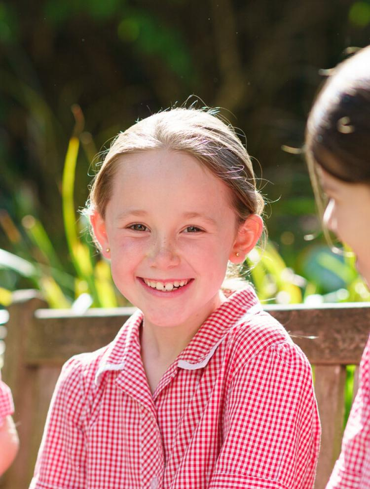 | 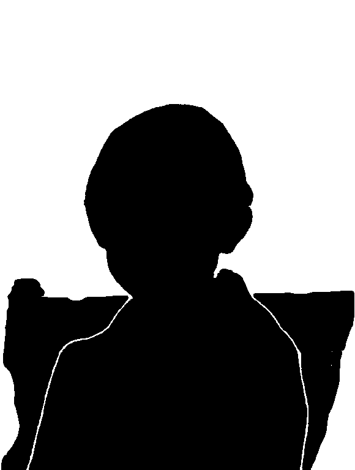 | 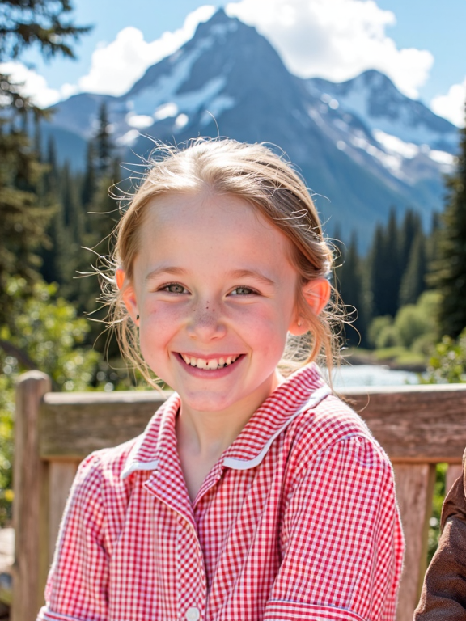 | / | bash ./testcases/bg_replacement.sh |
| Subject Replacement |  | 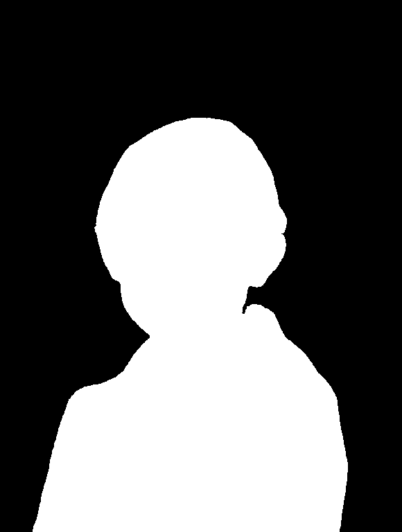 | 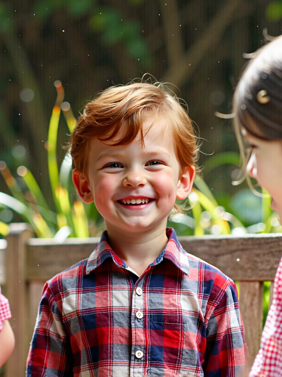 | / | bash ./testcases/subject_replacement.sh |
| Object Addition |  | 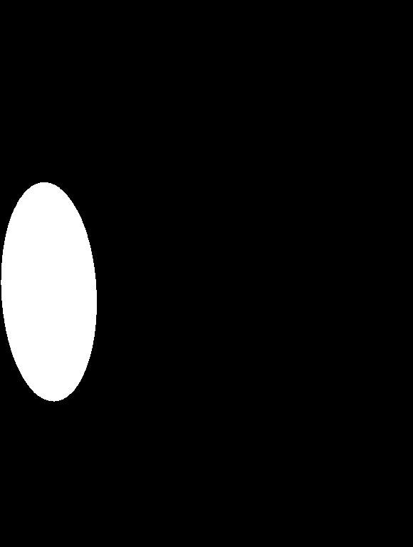 | 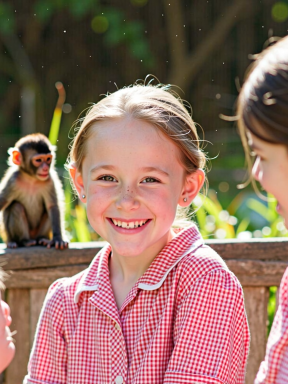 | / | bash ./testcases/add_monkey.sh |
| Subject Replacement<br>+Object Addition |  |  <br>  | 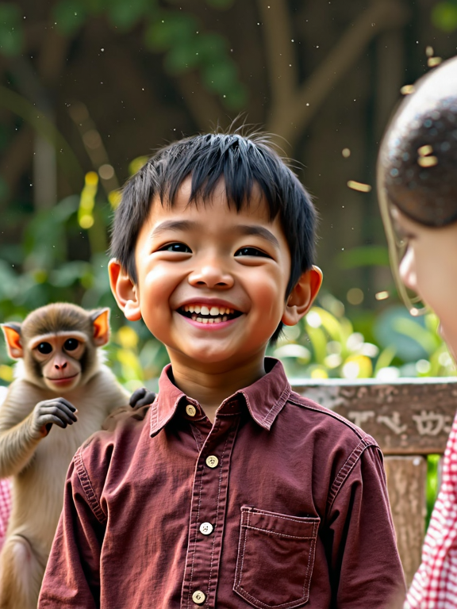 | / | bash ./testcases/subject_replace_object_add.sh |
| Subject Removal |  |  |  | / | bash ./testcases/subject_removal.sh |
| Subject Removal | 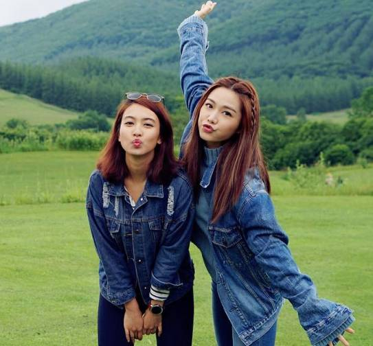 | 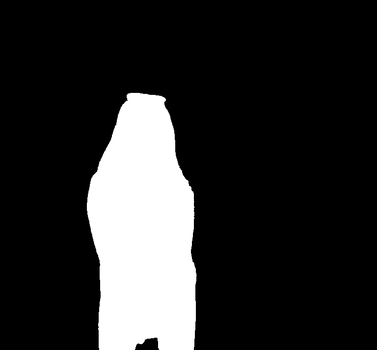 | 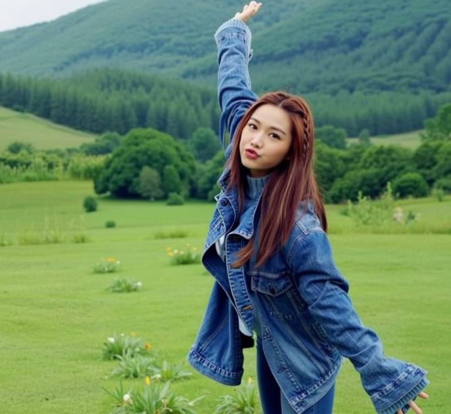 | / | bash ./testcases/subject_removal1.sh |
| Object Addition <br> with Mask Refinement <br>(binary mask) |  | 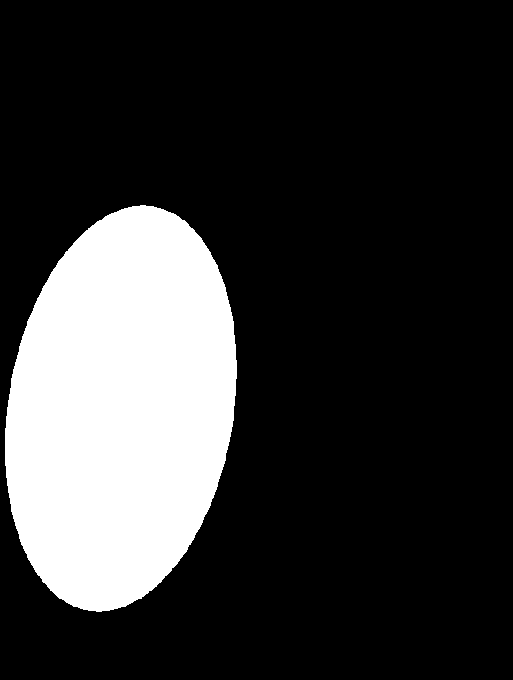 | 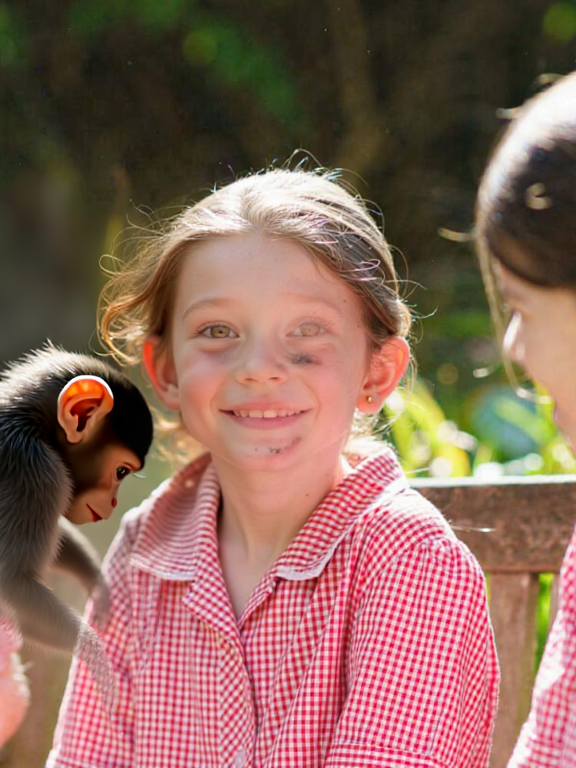 | 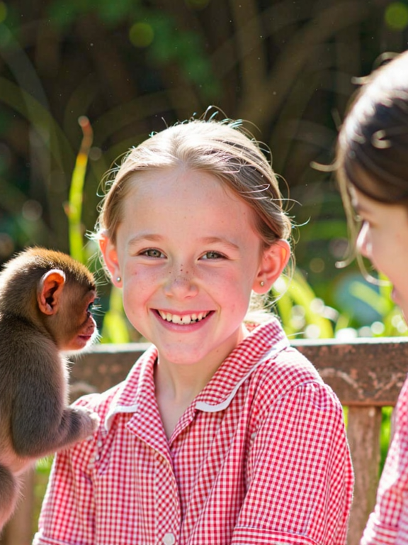 | bash ./testcases/add_monkey_w_refine.sh |
| Object Addition  <br>with Mask Refinement <br> (binary masks) |  | 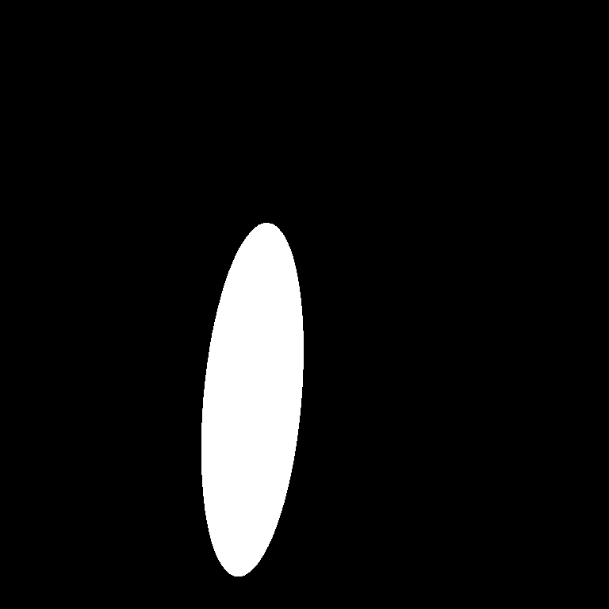 <br> 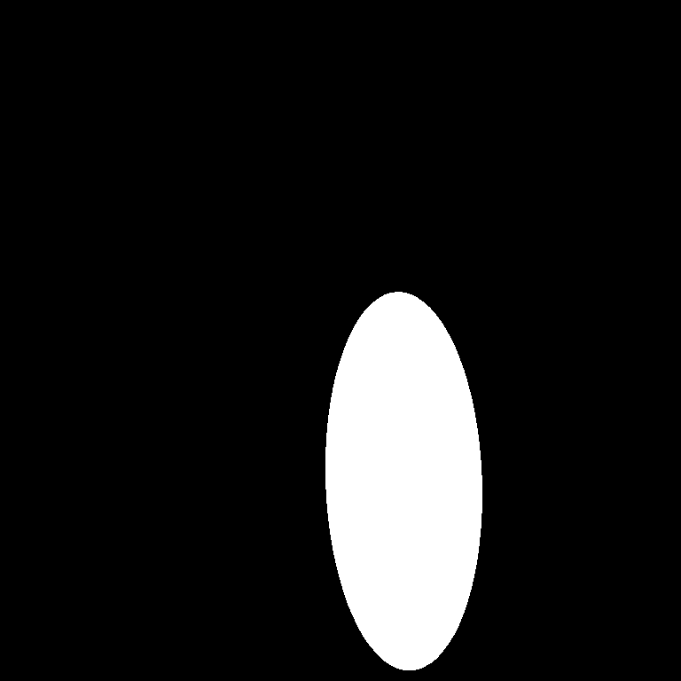 |  |  | bash ./testcases/add_manwoman_w_refine.sh |
| Object Addition  <br>with Mask Refinement <br> (point hint) |  | Point (x,y) <br> (0.12,0.35) | 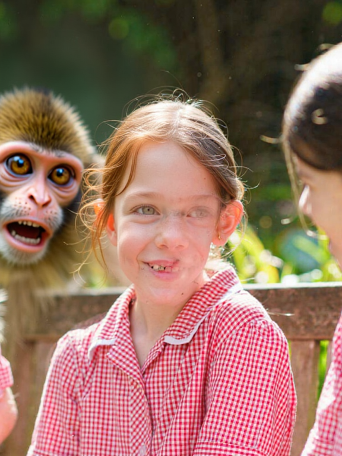 | 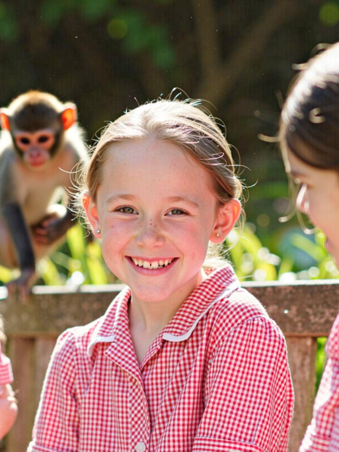 | bash ./testcases/add_monkey_point_refine.sh |
| Object Addition  <br>with Mask Refinement <br> (point hints) |  | Point (x,y) <br> (0.4,0.6) (0.6,0.6) |  |  | bash ./testcases/add_manwoman_point_refine.sh |
| Object Addition  <br>with Mask Refinement <br> (point hint) |  | Point Inferred by InternVL3 | 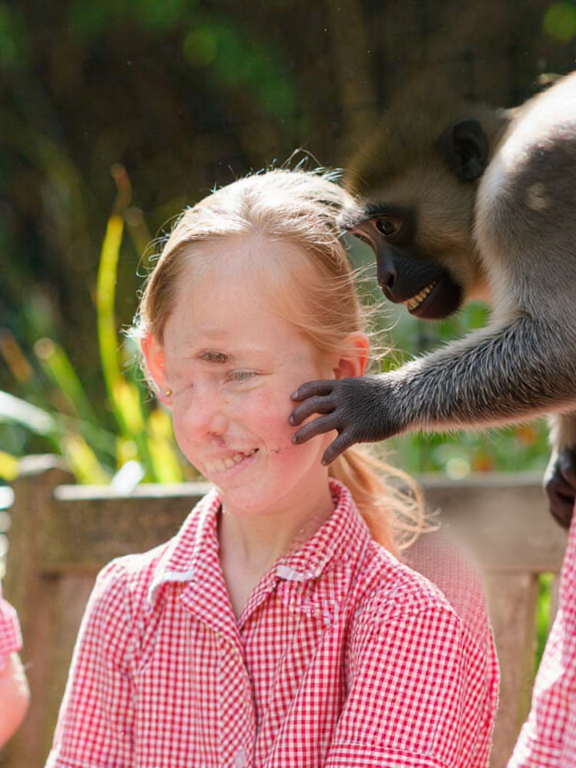 | 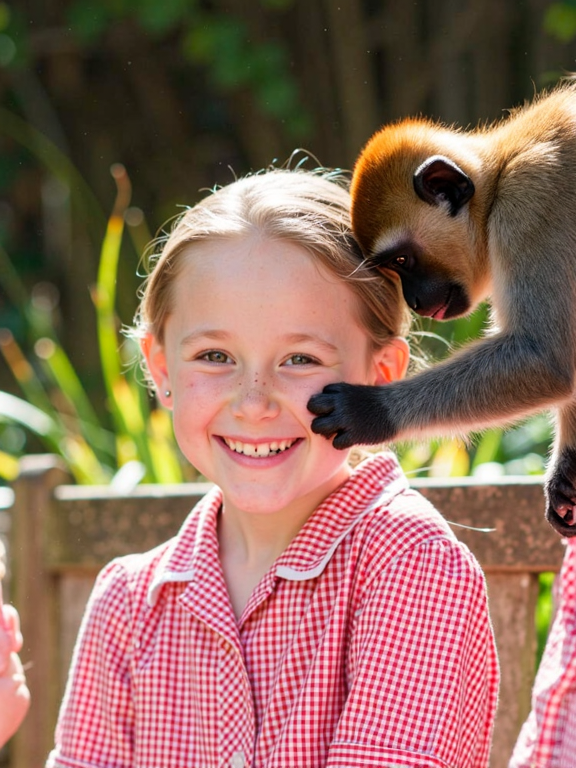 | bash ./testcases/add_monkey_point_autoinfer.sh |
| Object Addition  <br>with Mask Refinement <br> (point hints) |  | Points Inferred by InternVL3 |  |  | bash ./testcases/add_manwoman_point_autoinfer.sh |

### Explanations to key parameters in CannyEdit
```python
--image_path: Path to the image to be edited. (Required)

--save_location: Where to save the edited image. Default: './results/'.
  - If a folder is provided, the edited image will be saved inside that folder.
  - If a file path ending with '.png' is provided, the image will be saved to that exact path.

--width, --height: Output image width and height. Default: 768 for both.

--preserve_aspect_ratio: Preserve the original image’s width/height ratio.
  Default: False (uses square input/output).

--prompt_local: Text prompt describing the local edit region. Use '[remove]' to remove objects
  in the selected region. If omitted, the program will prompt you to enter it.

--prompt_source: Text prompt describing the source image. If omitted, Qwen2.5-VL-7B-Instruct
  will be used to generate it.

--prompt_target: Text prompt describing the desired outcome of the edited image. If omitted,
  Qwen2.5-VL-7B-Instruct will be used to generate it.
  Note: The VLM currently supports target prompts only for object addition and removal.
  For other types of edits, it’s recommended to provide this prompt explicitly.

--mask_input: Path(s) to binary mask(s) or tuple(s) of point(s) indicating where to edit.
  Points should be in the format (x,y) with values normalized to [0,1], e.g., "(0.4,0.6)".
  If omitted, an interactive tool will prompt you to provide the location.

--self_infer_point: When set (action='store_true'), and no add-location is provided,
  InternVL3-14B will infer point hints for object addition.

--dilate_mask: Dilate the mask region. (action='store_true')

--refine_mask: When set (action='store_true'), CannyEdit runs in two stages. First, it uses the initial user-provided edit location; then it displays the current editing result, prompts users to select refined masks, and runs CannyEdit again using those refined masks. Useful for object addition.

--auto_mask_refine: When used together (action='store_true') with --refine_location, CannyEdit runs in two stages. First, it uses the user-provided edit location; then it automatically refines the location with more precise masks and runs again. Useful for object addition

--multi_run: When set (action='store_true'), enables multiple effective editing passes.
  Generation latents are cached; after the first pass, you’ll be prompted for the next edits.

```

### Minimum GPU Requirement

To run CannyEdit, a GPU with at least 50 GB of VRAM is recommended.


## BibTeX

If you find our work useful, please consider citing:
```bibtex
@article{xie2025canny,
  title={CannyEdit: Selective Canny Control and Dual-Prompt Guidance for Training-free Image Editing},
  author={Xie, Weiyan and Gao, Han and Deng, Didan and Li, Kaican and Liu, April Hua and Huang, Yongxiang and Zhang, Nevin L.},
  journal={arXiv preprint arXiv:2508.06937},
  year={2025}
}

```

